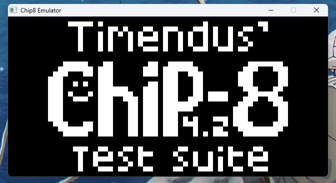
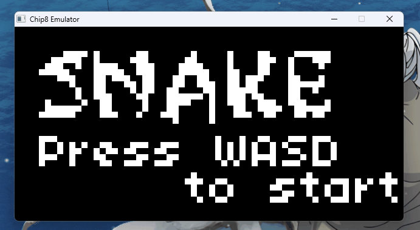

# CHIP-8 Emulator

A CHIP-8 emulator written from scratch in **C++17** with **SDL2**. It implements the full original CHIP-8 instruction set, a 16-key keypad, 60 Hz timers and sound, and passes the complete [Timendus CHIP-8 test suite](https://github.com/Timendus/chip8-test-suite), including quirk compatibility with the original COSMAC VIP.

<!-- Replace with your own screenshots/GIF, e.g. saved in a docs/ folder -->



## Features

- All 35 original CHIP-8 instructions
- 64×32 monochrome display, scaled 10× in an SDL2 window
- 16-key hexadecimal keypad mapped to the left side of a QWERTY keyboard
- Delay and sound timers counting down at 60 Hz
- Square-wave beep while the sound timer is active
- Original CHIP-8 behaviour for all quirks (VF reset, memory, display wait, clipping, shifting, jumping)
- Emulator core (`Chip8` class) is fully independent of SDL, so it can be ported to other platforms

## Test results

All tests from the [Timendus CHIP-8 test suite](https://github.com/Timendus/chip8-test-suite) pass:

| Test | Checks | Result |
|---|---|---|
| `1-chip8-logo` | Basic drawing | ✅ |
| `2-ibm-logo` | First six instructions | ✅ |
| `3-corax+` | All opcodes | ✅ |
| `4-flags` | VF carry/borrow/shift flags | ✅ |
| `5-quirks` | Original CHIP-8 quirks | ✅ |
| `6-keypad` | `EX9E`, `EXA1`, `FX0A` | ✅ |
| `7-beep` | Sound timer | ✅ |

## Building

### Requirements
- A C++17 compiler (tested with GCC 16)
- CMake 3.16+
- SDL2

### Windows (MSYS2)
Install the toolchain from the **MSYS2 UCRT64** terminal:
```
pacman -S mingw-w64-ucrt-x86_64-gcc mingw-w64-ucrt-x86_64-cmake mingw-w64-ucrt-x86_64-ninja mingw-w64-ucrt-x86_64-SDL2
```
Make sure `C:\msys64\ucrt64\bin` is on your `PATH`, then from the project folder:
```
cmake -S . -B build -G Ninja
cmake --build build
```

### Linux / macOS
Install SDL2 and CMake with your package manager (e.g. `sudo apt install libsdl2-dev cmake` or `brew install sdl2 cmake`), then run the same two `cmake` commands.

## Usage

```
./build/chip8 <path-to-rom>
```
For example:
```
./build/chip8 roms/2-ibm-logo.ch8
```
ROMs are not included in this repository. Test ROMs are available from the [Timendus test suite](https://github.com/Timendus/chip8-test-suite), and free games from the [CHIP-8 Archive](https://johnearnest.github.io/chip8Archive/) (choose games marked `chip8`).

## Controls

The CHIP-8 hex keypad is mapped to the left side of the keyboard:

```
CHIP-8 keypad      Keyboard
1 2 3 C            1 2 3 4
4 5 6 D            Q W E R
7 8 9 E     →      A S D F
A 0 B F            Z X C V
```

Each game uses its own keys. The [CHIP-8 database](https://chip-8.github.io/database) lists the controls for known games.

## Project structure

```
include/chip8.h    Chip8 class: memory, registers, stack, timers, display, keypad
src/chip8.cpp      Emulator core: ROM loading and fetch/decode/execute
src/main.cpp       SDL2 front end: window, rendering, input, audio, main loop
CMakeLists.txt     Build configuration
```

## How it works

Each frame (about 60 per second), the main loop:
1. Reads keyboard events and updates the keypad state
2. Runs 11 CPU instructions (≈700 instructions per second)
3. Decrements the delay and sound timers
4. Draws the display buffer to the window
5. Plays or pauses the beep based on the sound timer

Each instruction is fetched as two bytes from memory, decoded into its fields (`X`, `Y`, `N`, `NN`, `NNN`) with bit shifts and masks, and executed through a `switch` on its first hex digit.

## Resources

- [Tobias V. Langhoff — Guide to making a CHIP-8 emulator](https://tobiasvl.github.io/blog/write-a-chip-8-emulator/)
- [Timendus CHIP-8 test suite](https://github.com/Timendus/chip8-test-suite)
- [Lazy Foo' SDL2 tutorials](https://lazyfoo.net/tutorials/SDL/)

## License

MIT. See [LICENSE](LICENSE).
